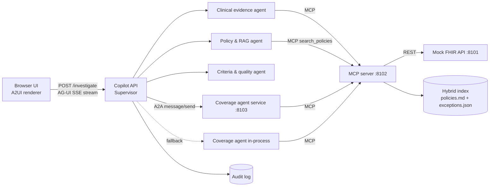

# Architecture (draft)

## Key decisions

1. **The LLM never decides.** Facts are quote-anchored and criteria are evaluated by fixed rules, so
   "never invent facts" and "never auto-deny" are enforced in code (`app/models.py` validators),
   not by prompting. Any language model output must pass the same quote verification.
2. **Missing is not negative.** `MISSING` and `NOT_SUPPORTED` are separate statuses. A not-met
   recommendation requires at least one affirmatively unmet criterion and always requires human review.
3. **Version selection is metadata-first, retrieval-second.** The policy in effect is chosen by
   family, service code, plan and service date. Retrieval ranks the whole corpus and then filters,
   so the trace shows which better-scoring superseded documents were excluded and why.
4. **Untrusted content is quarantined, not cleaned.** A document with instruction-like text stays
   visible to the reviewer but cannot contribute facts. The grounding validator rejects any
   criterion supported by quarantined evidence.
5. **Disagreement is rechecked once, then escalated.** It never gets "averaged away."
6. **Fail safe.** Tool budget, per-call timeouts, a bounded retry and an A2A fallback. If the
   pipeline cannot finish, the result is `MORE_INFORMATION_NEEDED` with no findings.

## Protocol boundaries

| Protocol | Where | What is real | Simplified |
|---|---|---|---|
| MCP | `mcp_server.py`, `agents/tools.py` | Official SDK, streamable HTTP, `tools/list` discovery, real calls from 3 agents | Read-only tools, no auth |
| A2A | `coverage_a2a.py`, `agents/a2a_client.py` | Agent card, JSON-RPC 2.0 `message/send`, Task with data artifact, separate process | No streaming, push or task persistence |
| AG-UI | `agui.py`, `api.py` | Standard event types and fields over SSE | Custom events for fallback, disagreement and A2UI |
| A2UI | `a2ui.py`, `frontend/` | `surfaceUpdate`/`beginRendering` envelope, fixed catalog, server and client validation | Custom catalog, no incremental data-model updates |
| FHIR | `fhir_store.py`, `fhir_api.py` | Resource types, ids, references, codings, periods, search by patient | No paging or modifiers; notes are Markdown files instead of base64 attachments |

## Known limitations (so far)

- The default semantic scorer is LSA (offline). A neural embedder is available with `EMBEDDINGS=sentence-transformers`.
- Note extraction is rule-based and tuned to the synthetic notes. The LLM extractor is the next step.
- One service (lumbar MRI) and one policy family. State is kept in memory, with the audit trail written to JSONL.
