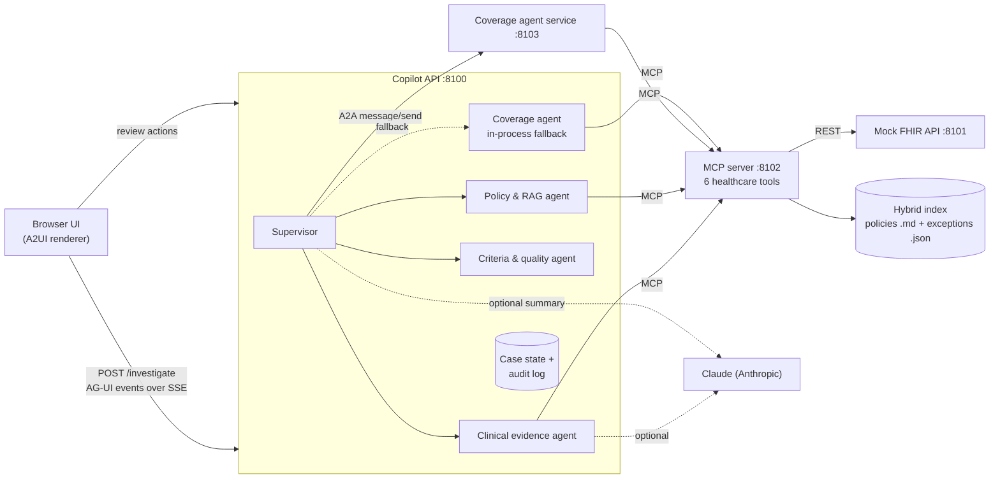

# Architecture

A small, working decision-support system for prior authorization of lumbar spine MRI (CPT 72148),
built on synthetic data. A reviewer opens a case, watches a supervisor and four specialist agents
investigate it live, inspects every piece of cited evidence, and records a decision. The system never
denies a request.

## System overview



| Service | Port | Code | Role |
|---|---|---|---|
| Copilot API and UI | 8100 | `app/api.py`, `frontend/dist/` | Runs the supervisor, streams AG-UI events, serves A2UI surfaces, reviewer actions, audit |
| Mock FHIR API | 8101 | `app/services/fhir_api.py` | Synthetic Patient, Condition, Observation, Encounter, DocumentReference, Coverage |
| MCP server | 8102 | `app/services/mcp_server.py` | Discoverable tools over streamable HTTP: `get_patient_context`, `search_fhir`, `get_clinical_notes`, `check_eligibility`, `get_authorization_history`, `search_policies` |
| Coverage agent (A2A) | 8103 | `app/services/coverage_a2a.py` | Separate service: agent card plus JSON-RPC `message/send` |

`scripts/run_all.sh` and `docker compose up` start all four as separate processes. With no service URLs set,
the API runs MCP and A2A in-process over in-memory transports (used by the tests).

## Agents

| Agent | Scope | Tools | Output |
|---|---|---|---|
| **Supervisor** (`agents/supervisor.py`) | Routes work, runs clinical and coverage in parallel, holds shared case state, enforces the tool budget and a single retry, detects cross-agent disagreement, composes and validates the result | A2A client, MCP (re-check) | `PAResult` + AG-UI events |
| **Clinical evidence** (`agents/clinical.py`, `extract.py`) | Diagnoses, encounters, observations, note excerpts. Separates **facts**, **ambiguities** and **gaps**. Quarantines injected or unverified documents | `search_fhir`, `get_clinical_notes` | Facts with evidence IDs, conflicts, gaps |
| **Policy & RAG** (`agents/policy.py`, `retrieval/index.py`) | Picks the policy version in effect; retrieves criteria, exceptions and exclusions with section IDs; shows superseded documents that ranked higher | `search_policies` | Policy, exceptions, citations, retrieval trace |
| **Coverage & eligibility** (`agents/coverage.py`) | Eligibility on the service date, plan, prior authorizations in the last 12 months | `check_eligibility`, `get_authorization_history` | Eligibility, plan, prior-imaging fact with evidence |
| **Criteria & quality** (`agents/criteria.py`, `models.py`) | Maps cited facts to criteria with fixed rules, evaluates exclusions, re-verifies every citation, validates the output schema | none | Criterion and exclusion results, citation problems |

## Data flow for one case

```mermaid
sequenceDiagram
  participant UI
  participant SUP as Supervisor
  participant CE as Clinical agent
  participant COV as Coverage agent (A2A)
  participant PR as Policy agent
  participant CQ as Criteria agent
  participant MCP as MCP server
  UI->>SUP: POST /investigate
  SUP-->>UI: RUN_STARTED, STATE_SNAPSHOT
  par in parallel
    SUP->>CE: run(case)
    CE->>MCP: search_fhir x3, get_clinical_notes
    CE-->>SUP: facts, conflicts, gaps, quarantined docs
  and
    SUP->>COV: A2A message/send
    COV->>MCP: check_eligibility, get_authorization_history
    COV-->>SUP: eligibility, plan, prior auths
  end
  SUP->>SUP: compare agents (prior imaging); re-check once; escalate if still different
  SUP->>PR: run(case, plan)
  PR->>MCP: search_policies (hybrid, filtered by plan/service/date)
  PR-->>SUP: policy version + reason, exceptions, exclusions
  SUP->>CQ: evaluate(policy, facts, conflicts)
  CQ-->>SUP: criteria + exclusions, citation check
  SUP->>SUP: decide, validate PAResult (fallback to SPECIALIST_REVIEW if invalid)
  SUP-->>UI: CUSTOM a2ui (surfaceUpdate), RUN_FINISHED
```

Every tool call is streamed as `TOOL_CALL_START/ARGS/END/RESULT`. Fallbacks, retries, disagreements,
exclusions and retrieval exclusions are streamed as `CUSTOM` events. Failures are streamed as `RUN_ERROR`.

### How the recommendation is decided (in order)

1. Citation check failed → `SPECIALIST_REVIEW`
2. A policy exclusion applies → `SPECIALIST_REVIEW` (physician review; the system does not deny)
3. Red-flag findings documented → `MEETS_CRITERIA` (expedite)
4. Coverage unavailable or not eligible → `MORE_INFORMATION_NEEDED`
5. Any criterion `CONFLICTING` → `SPECIALIST_REVIEW`
6. All criteria `SUPPORTED` → `MEETS_CRITERIA`
7. Any criterion affirmatively `NOT_SUPPORTED` → `DOES_NOT_APPEAR_TO_MEET_CRITERIA` (always human review)
8. Otherwise (something `MISSING`) → `MORE_INFORMATION_NEEDED`

## Key decisions

1. **The LLM never decides.** Facts are quote-anchored and criteria are evaluated by fixed rules, so "never
   invent facts" and "never auto-deny" are enforced in code (`app/models.py` validators), not by prompting.
2. **Missing is not negative.** `MISSING` and `NOT_SUPPORTED` are separate statuses. A not-met recommendation
   needs at least one affirmatively unmet criterion and always requires human review. Exclusions likewise apply
   only on cited evidence; absence is `NOT_DOCUMENTED`.
3. **Version selection is metadata-first, retrieval-second.** The policy in effect is chosen by family, service,
   plan and service date. Retrieval ranks the whole corpus and then filters, so the trace shows which
   better-scoring superseded documents were excluded and why.
4. **Three layers against untrusted content.** (a) Documents with instruction-like text are quarantined and never
   sent to the model. (b) Documents from unverified sources (an inbound fax) never establish facts; their claims
   go to the reviewer for verification. (c) Even content that gets through cannot set the recommendation.
5. **Disagreement is rechecked once, then escalated.** It is never averaged away.
6. **Fail safe, never fabricate.** Tool budget, per-call timeouts, one retry, an A2A fallback, and a safe result
   (`MORE_INFORMATION_NEEDED` with no findings) when the pipeline cannot finish.
7. **Notes are cross-checked against structured data.** A note claiming 8 weeks of therapy is compared with the
   dated therapy encounters; a gap of more than 2 weeks, or a non-attendance note, makes the criterion
   `CONFLICTING`.

## Output contract

`PAResult` (`app/models.py`) extends the suggested format with `policy_selection_reason`, `exceptions_applied`,
`exclusions`, `red_flag_pathway`, `contradictions`, `security_flags`, `evidence` (every ID → source type,
section, verbatim quote, date), `agent_status`, `summary_source` and `llm_usage`. Its validators reject:

- a conclusion that cites no evidence, or cites an ID that does not exist;
- support from quarantined evidence;
- an applicable exclusion without clinical evidence, or an exclusion together with `MEETS_CRITERIA`;
- a not-met recommendation without an affirmatively unmet criterion, or without human review.

If the result fails validation, it is withheld and replaced by a `SPECIALIST_REVIEW` result.

## LLM layer (Anthropic Claude)

`app/llm.py`, enabled by `LLM_PROVIDER=anthropic` and `ANTHROPIC_API_KEY` in `.env`. Default model `claude-sonnet-5-5`.

| Step | Model's job | Verified in code | If it fails |
|---|---|---|---|
| Fact extraction | Read one trusted note, return JSON items with verbatim quotes | Allowed kind and type, quote found verbatim, number present in the quote, negation check | Retry once, then rule-based extraction for that note |
| Union with rules | Adds facts the rules missed | Same checks | Rules alone |
| Summary | 3–5 plain sentences (≤ 120 words) from structured findings only, no demographics | Cited IDs exist and are not quarantined, states the recommendation, no approve/deny wording, markdown stripped | Template summary |

Quarantined and unverified documents are never sent to the model. Prompts carry opaque IDs, never names or
birth dates. Tests always use a scripted model, even when `.env` holds a key.

## Protocol boundaries

| Protocol | Where | What is real | Simplified |
|---|---|---|---|
| MCP | `mcp_server.py`, `agents/tools.py` | Official SDK, streamable HTTP, `tools/list` discovery, real calls from 3 agents | Read-only tools, no auth; demo fault route is HTTP-only, not an MCP tool |
| A2A | `coverage_a2a.py`, `agents/a2a_client.py` | Agent card, JSON-RPC 2.0 `message/send`, Task with a data artifact, separate process | No streaming, push or task persistence |
| AG-UI | `agui.py`, `api.py` | Standard event types and camelCase fields over SSE; `RUN_FINISHED` is always last | Custom events for fallback, disagreement, exclusions and A2UI |
| A2UI | `a2ui.py`, `frontend/` | `surfaceUpdate`/`beginRendering` envelope, fixed catalog of 6 components, validated on server and client | Custom catalog, no incremental data-model updates |
| FHIR | `fhir_store.py`, `fhir_api.py` | Resource types, IDs, references, codings, periods, search by patient | No paging or modifiers; notes are Markdown files rather than base64 attachments; Observation values are strings |

## Human in the loop and audit

Reviewer actions (`app/store.py`): **request clarification**, **supply or correct data** (a source note is
mandatory; the input becomes cited evidence `REVIEW/<id>` and the case is re-run), and **record a disposition**
(APPROVE, REQUEST_MORE_INFORMATION, REFER_TO_PHYSICIAN_REVIEWER). Approval is blocked unless the current result
is `MEETS_CRITERIA`; nothing in the system can deny. Every action is appended to `.runtime/audit.jsonl` with a
timestamp, the actor, the run ID and the system recommendation, but no clinical text.

## Tradeoffs

| Choice | Why | Cost |
|---|---|---|
| Rules decide, LLM assists | Provable grounding, reproducible evaluation, no model-made denials | Less flexible than end-to-end LLM reasoning; rules must be written per policy |
| Criteria as structured front matter beside the policy text | One source for retrieval and rules; exact thresholds | Policies must be authored or converted into this format |
| Offline LSA as the semantic scorer | Runs with no key or download; deterministic | Weaker on synonyms than neural embeddings (see `EVALUATION.md`) |
| Plain-Python supervisor, not a framework | Every decision point is visible and testable | Re-implements what LangGraph-style frameworks give for free |
| Hand-built A2A subset | Small, readable, no SDK churn | Not the full spec (no streaming or task store) |
| In-memory case state + JSONL audit | Zero setup | Not durable or multi-user |
| Vanilla JS UI with no build step | Nothing to install; easy to read | Plain styling |

## Cost

Rules-only mode uses no tokens. With Claude, a case makes one extraction call per trusted note plus one summary
call: about 1,800–2,500 input and 500–1,000 output tokens per case in the live smoke test. At list price for
Claude Sonnet 5.5 ($2 / M input, $10 / M output), that is roughly **$0.01 per case**. `scripts/evaluate.py --mode llm`
measures it on all 9 cases.

## Assumptions and shortcuts

- **Synthetic data only**: 9 patients, 12 notes, 2 policy versions, 2 date-limited exceptions, 2 exclusions. All
  labels were written by the developer.
- **One service** (CPT 72148) **and one policy family.** Plans: PPO-GOLD, HMO-STD, HMO-RURAL.
- **Note extraction is pattern-based by default**, tuned to how the synthetic notes are written. The LLM extractor
  adds coverage.
- **Source trust is binary**: EHR documents are trusted, everything else (e.g. fax) is unverified until a reviewer
  confirms it.
- **No authentication**, no real payer or provider transactions, and no persistence beyond the audit file.
- **Red flags and exclusions are keyword-detected** from notes and diagnosis codes.

## Known limitations

- **Injection detection is pattern-based** and catches 3 of 5 test variants. Source trust and the rules-decide
  structure contain the other two, but a malicious note from a *trusted* source that avoids the patterns could
  still contribute facts.
- **Retrieval** is evaluated on a small corpus (about 20 sections, 20 queries), where hybrid ranking does not beat
  either single method. Synonym queries expose the limits of LSA.
- **LLM output varies from run to run** (this SDK version exposes no sampling controls). All of it is verified, but
  verification proves a quote exists, not that it was labeled correctly; the number and negation checks catch
  common mislabels, not all.
- **Small evaluation sets.** They are a regression suite for the designed scenarios, not a measure of real-world
  accuracy.

## Unfinished / next steps

- Trained injection classifier; trust levels per source instead of trusted/unverified.
- Neural embeddings and a larger policy corpus (more services and policy families).
- Durable case store and authentication for multi-user review.
- A2A streaming for long-running agents; MCP authorization.
